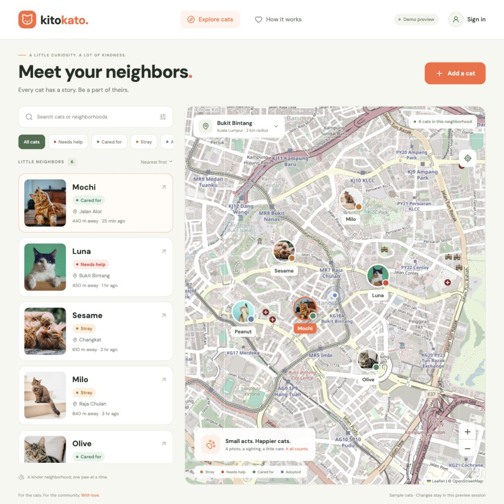

# KitoKato

A mobile-first field guide to neighborhood cats. Share a cat with a photo and location, discover cats on a map, and leave comments or status updates.

**Current stage:** an interactive Expo MVP with a working sample-data preview and a Firebase service layer. Live Firebase and native-device verification are still pending. Last documented: October 25, 2026.



## Start the preview

Run these commands from the repository root, not `my-app/`:

```sh
npm ci --legacy-peer-deps
npm run web
```

Open [localhost:8081](http://localhost:8081). Without Firebase configuration, the app uses sample cats in Kuala Lumpur. Choose **Continue as a demo explorer** when prompted to add a cat, comment, or update a status. Demo changes reset when the page reloads; no real account is created.

Use Node.js **24.3 or later within the 24.x release line** for a common version accepted by the installed app dependencies. See the setup guide for other supported versions and native prerequisites.

## What you can do

- Explore the map or cat list, search loaded cats, and filter by status or distance.
- Open a cat profile with a photo, description, location, and comments.
- Choose and resize a photo, enter coordinates or use your location, and submit a cat.
- Add comments and change a cat's status after signing in or entering the demo account.

The sighting service supports photo sightings, but the current UI exposes status updates rather than a separate photo-sighting form. Demo mode does not exercise Firebase security rules or rate limits.

## Stack and source

The app uses Expo 58, React Native, TypeScript, Firebase Auth/Firestore/Storage, and Zustand. Browser maps use Leaflet/OpenStreetMap; native maps use the Google provider through `react-native-maps`. Exact dependencies are recorded in [package.json](package.json) and the lockfile.

```text
App.tsx                  App shell, auth subscription, modal navigation
src/screens/             Home, Add Cat, Cat Detail, Auth
src/components/          Shared controls, cat cards, platform-specific maps
src/store/               Zustand state and demo/live coordination
src/services/            Firebase initialization and service functions
src/config/              Environment configuration and demo selection
src/data/                Sample cats and comments
src/types/               Persisted models and UI types
src/utils/               Validation, errors, display formatting
firebase/                Rules, indexes, and isolated emulator tests
artifacts/               Saved preview screenshot
my-app/                  Original Svelte/Prisma starter; not the active app
```

## Documentation

- [Getting started](docs/getting-started.md): demo walkthrough, environment setup, Firebase deployment, and troubleshooting.
- [Architecture](docs/architecture.md): components, state, platform differences, and data flows.
- [Service API](docs/service-api.md): function contracts, validation, pagination, and upload recovery.
- [Firestore schema and rules](docs/firestore-schema.md): collections, relationships, indexes, permissions, and limits.
- [Testing and readiness](docs/testing.md): previous checks, outstanding work, and a final acceptance checklist.

## Useful commands

- `npm run web` — browser development server on port 8081.
- `npm start` — Expo development server.
- `npm run ios` / `npm run android` — launch through Expo tooling; native setup is still required.
- `npm run typecheck` — TypeScript checking.
- `npm run export:web` — generate a web build in `dist/`; this does not publish it.

Firebase test dependencies are separate: run `npm ci` and `npm test` inside `firebase/` when ready for rule testing. See [testing instructions](docs/testing.md) before interpreting the results.
